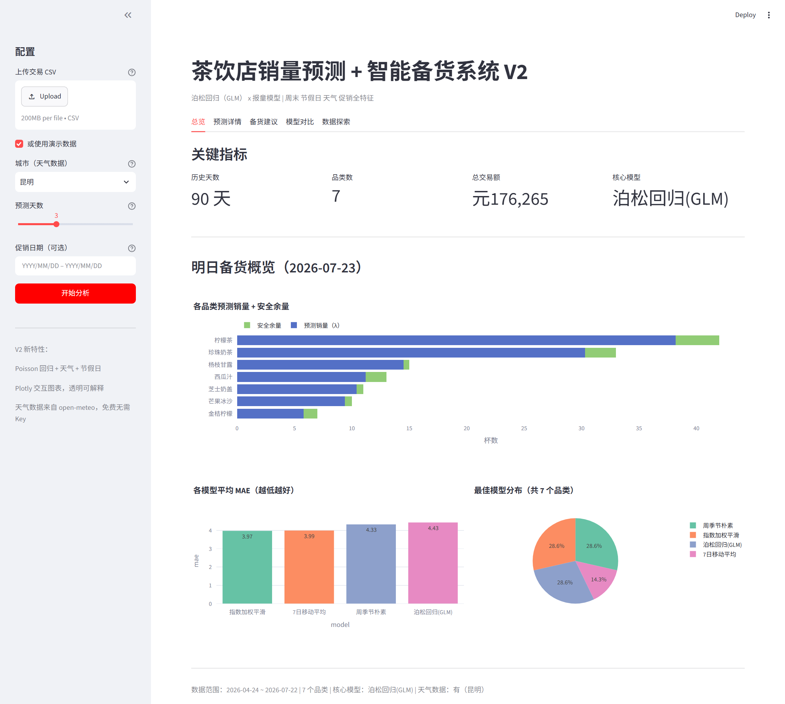

# 茶饮店销量预测 + 智能备货系统 V2


**明天每个品类备多少杯？让数据算，别靠感觉。**

茶饮店每天都在赌同一件事：备少了断货，备多了报废。这个系统把周末、节假日、天气、促销这些影响因素拟合进泊松回归，再用报童模型算出"缺货损失与报废损失平衡点"上的最优备货量。每一步都透明可解释，系数能看懂为什么。



## 快速开始

```bash
# 安装依赖
pip install -r requirements.txt

# 方式一：Streamlit 仪表板（推荐）
streamlit run tea_shop_app.py

# 方式二：命令行
python tea_shop_v2.py --demo
python tea_shop_v2.py --demo --city 北京 --horizon 7
```

## 核心特性

- **Poisson 回归 (GLM)**：statsmodels GLM 拟合，特征包括周末、节假日、温度、降雨、促销
- **3 个基线模型对比**：7日移动平均、指数加权平滑、周季节朴素
- **泊松报童模型**：`Q* = poisson.ppf(Cu/(Cu+Co), λ)` 计算最优备货量
- **免费天气数据**：open-meteo API，无需注册，自动缓存
- **中国节假日**：chinesecalendar 库，自动识别法定节假日和调休
- **1-7 天预测**：可选择预测天数，天气预报自动匹配
- **CSV 导出**：备货建议一键下载

## CSV 数据格式

| 列名 | 必填 | 说明 |
|------|------|------|
| 交易编号 | 是 | 唯一标识 |
| 商品名称 | 是 | 品类名 |
| 数量 | 是 | 销售数量（杯） |
| 单价 | 否 | 售价，没有则无法计算利润 |
| 单位成本 | 否 | 原料成本，没有则默认=单价×40% |
| 日期 | 是 | YYYY-MM-DD 格式 |

## 仪表板功能

| Tab | 内容 |
|-----|------|
| 总览 | KPI 卡片 + 预测 vs 备货柱状图 + 模型 MAE 对比 + 最佳模型分布 |
| 预测详情 | 品类选择器 + 历史销量与预测叠加图 + GLM 系数表 |
| 备货建议 | Newsvendor 备货表 + 每日 Q* 柱状图 + CSV 下载 |
| 模型对比 | 4 模型 × 每品类分组柱状图 + 回测成绩热力图 |
| 数据探索 | 工作日/周末对比 + 节假日对比 + 温度-销量散点图 + 星期几分布 |

## 原理

### 泊松回归

```
log(λ) = β₀ + β₁·is_weekend + β₂·is_holiday + β₃·temperature_max
       + β₄·precipitation_sum + β₅·is_promotion + Σγᵢ·C(itemᵢ)
```

系数直接可解释：exp(β₁) = 周末相对工作日的需求倍数。

### 报童模型

```
Cu = 售价 − 成本（缺货损失）
Co = 成本（过剩损失）
Fr = Cu / (Cu + Co)
Q* = poisson.ppf(Fr, λ)
```

## 依赖

`streamlit plotly pandas numpy scipy statsmodels requests chinesecalendar`

## 天气数据

支持 14 个中国城市，通过 open-meteo 免费 API 获取历史和预报数据。选"无天气数据"时仅用日历特征。数据本地 Parquet 缓存，增量更新。

## 致谢

本项目站在三位巨人的肩膀上，衷心感谢以下开源项目和作者：

### 核心参考项目

| 项目 | 作者 | 核心贡献 | 致谢 |
|------|------|---------|------|
| [Cafe-Demand-Forecasting-Reorder-Simulator](https://github.com/AmirhosseinHonardoust/Cafe-Demand-Forecasting-Reorder-Simulator) | Amirhossein Honardoust | 完整数据处理流水线、三模型回测框架、Streamlit 仪表板架构 | 提供了 V1 的架构蓝图和 V2 的 Streamlit 参考实现。数据清洗、按天汇总、缺失日期填 0、回测选优的逻辑均源自此项目。 |
| [NewsvendorPoissonDemand](https://huggingface.co/spaces/geedubyuh/NewsvendorPoissonDemand) | geedubyuh | 纯泊松报童模型，代码不到 50 行，数学最干净 | 提供了核心公式 `Q* = poisson.ppf(Cu/(Cu+Co), λ)` 的 Python 实现。正是此项目让我们确信：泊松比正态更适合茶饮店。 |
| [WasteNot](https://github.com/huangk430/WasteNot) | Kelly Huang | 泊松回归 + 外部特征（天气/节假日）的方法论验证 | 提供了"把天气和节假日塞进泊松回归"的学术验证。用德国餐厅两年数据证明了这条路的可行性，给我们升级 V2 的底气。 |

### 数据与服务

- **[open-meteo](https://open-meteo.com/)** — 完全免费的全球天气 API，无需注册，无需 API Key。提供 1940 年至今的历史天气和未来 16 天预报。
- **[chinesecalendar](https://github.com/LKI/chinese-calendar)** — 中国法定节假日 Python 库，自动处理调休，让模型知道哪天是真放假、哪天是"假装上班"。

### V2 整合思路

```
Cafe-Demand-Forecasting  →  数据处理流水线 + 三模型回测 + Streamlit 参考
NewsvendorPoissonDemand  →  泊松报童模型 Q* = poisson.ppf(Fr, λ)
WasteNot                 →  泊松回归 × 外部特征的方法论验证
        ↓
tea-shop-forecast V2  =  三者精华 × 中国本地化（天气+节假日+促销）
```

没有这些开源项目的无私分享，就没有这个脚本。如果大哥们的茶饮店生意因此多赚了钱，请给这三个项目的作者点个 Star。

## License

MIT
